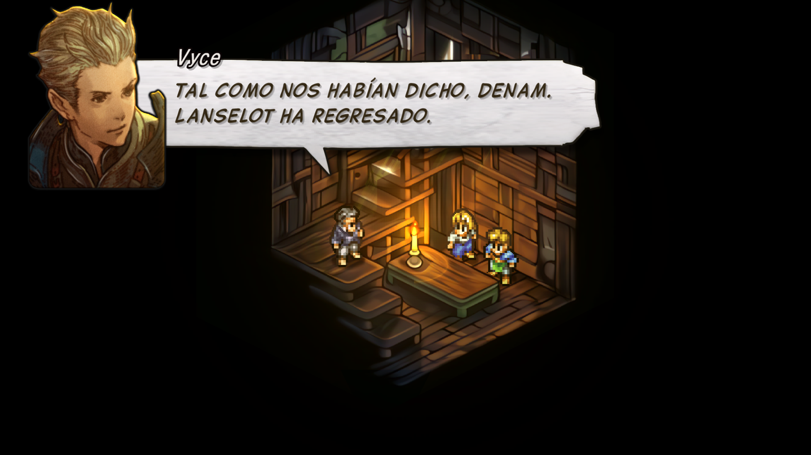
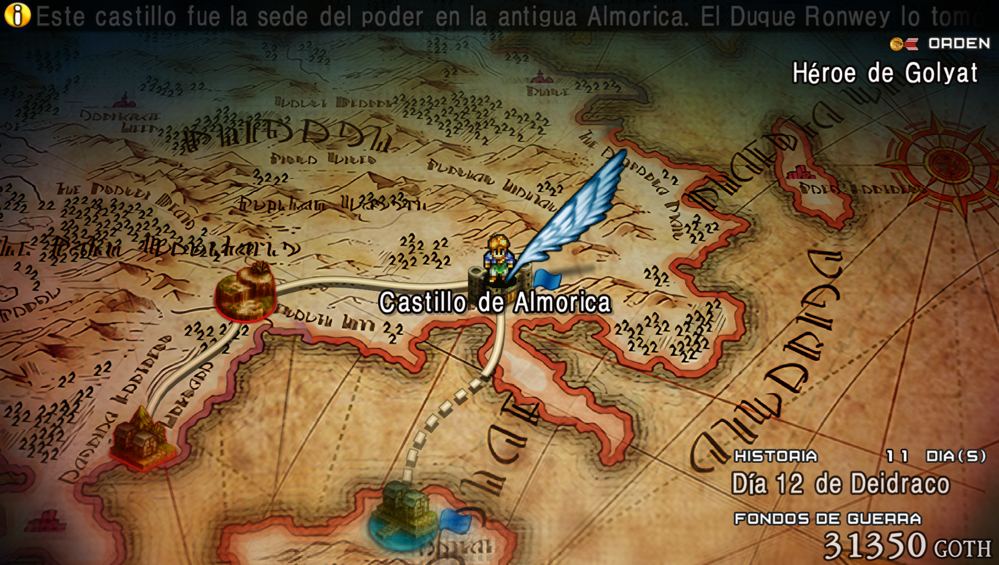
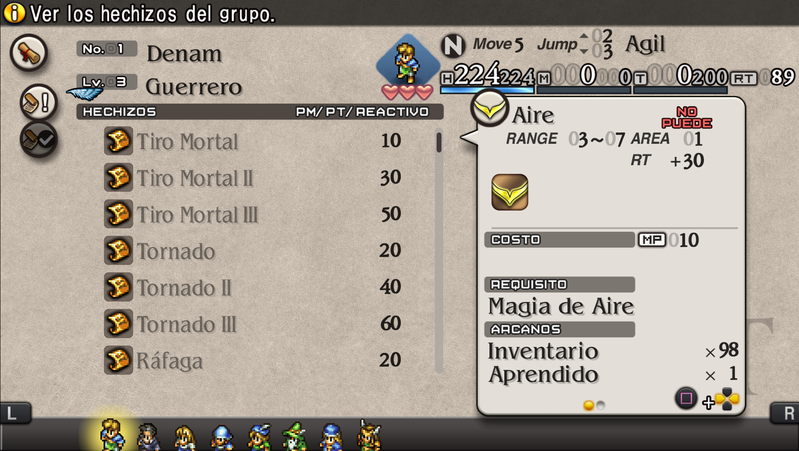
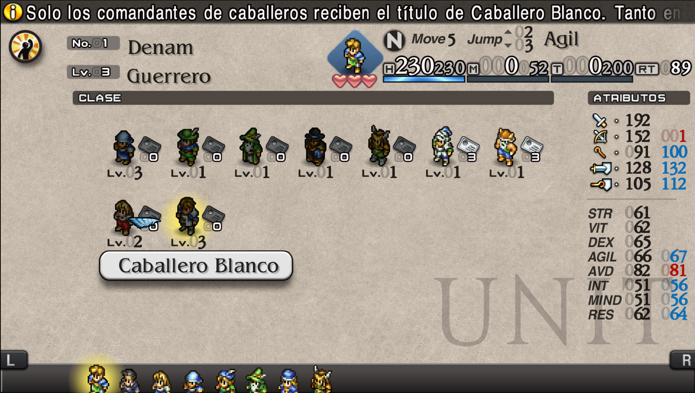

# Tactics Ogre: Let Us Cling Together — One Vision (PSP)
## Traducción al español

Proyecto de traducción no oficial al español neutro de **Tactics Ogre: Let Us Cling Together para PSP**, compatible con **One Vision v1.11d**, el mod de raics.

La descarga pública se distribuye como un parche **xdelta**. No se distribuyen imágenes ISO ni archivos originales del juego.

## ¿Por qué One Vision y no la versión Vanilla?

Elegí **One Vision** porque no se limita a aumentar la dificultad: replantea muchos de los sistemas de combate de *Tactics Ogre* para ofrecer una experiencia más equilibrada, variada y estratégica. Para mí, su mayor atractivo está en las posibilidades que abre a la hora de formar un ejército y desarrollar equipos diferentes.

- **Team building y personalización:** los personajes genéricos cuentan con perfiles y atributos más variados, orientados a distintos estilos —como luchador, pícaro, mago o generalista—. Esto hace que reclutar, combinar y desarrollar unidades tenga más peso en la composición del equipo.
- **Mejor equilibrio:** armas, clases y habilidades se reajustan para acercar su rendimiento y evitar que unas pocas opciones o combinaciones dominen los combates. También se revisan las habilidades especiales y los movimientos finales.
- **Más opciones de clases y combate:** numerosas clases reciben ajustes y nuevas posibilidades, y el mod incorpora opciones adicionales de equipo, habilidades, técnicas y hechizos. Así hay más formas de definir el papel de cada unidad dentro del grupo.
- **Armas y equipamiento renovados:** se revisan armas, armaduras y objetos para que sus características tengan una función más clara. Por ejemplo, las armas a dos manos destacan por su daño y las armaduras pesadas permiten construir unidades resistentes.
- **Menos grindeo repetitivo:** One Vision acelera el progreso de habilidades que antes tardaban demasiado en subir, facilita conseguir muchos objetos y simplifica la fabricación. Además, elimina buena parte de los métodos de obtención de estadísticas permanentes, reduciendo la necesidad de repetir actividades únicamente para mejorar números.

Por estas razones prefiero jugar con One Vision: me gusta experimentar con distintas composiciones, aprovechar las fortalezas de cada clase y ganar los combates mediante la estrategia y la preparación del equipo, en lugar de depender de unas pocas configuraciones demasiado poderosas.

Para consultar los detalles del mod, sus clases, armas, armaduras, objetos, personajes, habilidades y demás contenido, visita la **[base de datos de One Vision](https://ogre-db.github.io/one-vision/)**. También puedes leer la **[descripción y los objetivos del mod en ModDB](https://www.moddb.com/mods/one-vision1)** y las **[notas de cambios de sus versiones](https://www.moddb.com/mods/one-vision1/downloads/one-vision1)**.

## Capturas del proyecto

  
  

  
  

## Descargar la traducción

**[Descargar la última versión desde GitHub Releases](https://github.com/Bringerx13/Tactics-Ogre-One-Vision-ESP/releases/latest)**

En la sección *Assets* de la publicación, descarga el archivo `.xdelta` correspondiente a la versión que quieras instalar.

## Requisitos y compatibilidad

- Una copia propia de **Tactics Ogre: Let Us Cling Together para PSP**, probado en la edición **USA**.
- **One Vision v1.11d**.
- Para preparar una ISO en PC: [7-Zip](https://www.7-zip.org/) y [UMDGen](https://www.romhacking.net/utilities/1218/).
- Para aplicar el parche en PC: [Delta Patcher](https://github.com/marco-calautti/DeltaPatcher/releases).
- Para jugar: [PPSSPP](https://www.ppsspp.org/download/).

**Región compatible con este parche:** USA, código **ULUS10565**.

> **Importante:** el parche xdelta solo funciona con la ISO USA de One Vision v1.11d preparada de la misma forma que la ISO utilizada para crear el parche. No lo apliques sobre una ISO limpia, una versión distinta de One Vision. Si el programa informa que el archivo original no coincide, detente y comprueba la fuente.

## 1. Instalar One Vision en PC (crear una ISO)

Este es el método recomendado para preparar la ISO que necesita nuestro parche español. Las imágenes son capturas de la [guía oficial de instalación de One Vision](https://ogre-db.github.io/one-vision/installation.html); algunas muestran una versión anterior del mod, pero ilustran el mismo procedimiento general.

### Descargar y extraer One Vision

1. Descarga **One Vision v1.11d** desde [ModDB](https://www.moddb.com/mods/one-vision1/downloads/one-vision1).
2. Coloca el archivo `.7z` de One Vision y tu ISO USA original en una carpeta de trabajo.
3. Extrae el archivo `.7z` de One Vision con 7-Zip. En la carpeta extraída debe aparecer `PSP_GAME`.

  

### Aplicar los archivos del mod con UMDGen

4. Abre **UMDGen** y carga tu ISO USA original.
5. Comprueba que estás en la raíz de la imagen y que aparece la carpeta `PSP_GAME`.
6. Desde la carpeta extraída de One Vision, arrastra la carpeta principal `PSP_GAME` del mod a la ventana de UMDGen.
7. Cuando UMDGen pregunte si deseas reemplazar los archivos, selecciona **Yes to All**.

  
  

  
  

> **No uses las carpetas `DataInstall Fix USA` ni `DataInstall Fix EUR` para preparar la ISO de origen de esta traducción.** Para este parche, aplica únicamente la carpeta principal `PSP_GAME` de One Vision v1.11d. No añadas correcciones adicionales de Data Install.

### Guardar la ISO de One Vision

8. En UMDGen, selecciona **File → Save As → Uncompressed (*.iso)**.
9. Guarda la imagen con un nombre nuevo, por ejemplo `Tactics_Ogre_One_Vision_v1.11d_USA.iso`. No sobrescribas tu ISO original.
10. Conserva esta ISO: será el archivo de origen para aplicar la traducción.

  
  

## 2. Aplicar la traducción en PC

1. Descarga el parche `.xdelta` desde [GitHub Releases](https://github.com/Bringerx13/Tactics-Ogre-One-Vision-ESP/releases/latest).
2. Abre **Delta Patcher**.
3. Selecciona los archivos:
   - **Original file:** `Tactics_Ogre_One_Vision_v1.11d_USA.iso`, creada en el apartado anterior.
   - **XDelta patch:** el archivo `.xdelta` descargado.
   - **Output file:** la ubicación y el nombre de la ISO traducida, por ejemplo `Tactics_Ogre_One_Vision_ESP.iso`.
4. Aplica el parche. No selecciones la ISO original sin modificar.
5. Abre la ISO española resultante en PPSSPP.

## 3. Instalar One Vision en un celular Android (método de carpeta de PPSSPP)

La guía oficial de One Vision también permite instalar el mod en Android sin reconstruir una ISO. Este método extrae el juego y combina las carpetas para que PPSSPP lo ejecute directamente.

**Atención:** este método instala One Vision en una carpeta, pero **no crea la ISO que necesita nuestro parche xdelta**. Úsalo para jugar la versión de One Vision desde una carpeta. Para jugar nuestra traducción española, consulta el apartado **4. Aplicar y jugar la traducción en un celular**.

### Preparar los archivos

Necesitarás:
- Tu ISO USA original de Tactics Ogre.
- El archivo de One Vision v1.11d en formato `.7z`.
- Una aplicación para extraer archivos `.7z` y archivos de juego (la guía oficial usa 7Z).
- Un administrador de archivos para copiar y combinar carpetas.
- PPSSPP instalado.

1. Descarga One Vision v1.11d desde [ModDB](https://www.moddb.com/mods/one-vision1/downloads/one-vision1).
2. Coloca el archivo `.7z` de One Vision y tu ISO original en una misma carpeta del almacenamiento del teléfono.
3. Abre tu aplicación de extracción, toca la ISO y selecciona **Attempt Extract** y después **Extract here**. Se creará una carpeta con los archivos del juego.
4. Extrae también el archivo `.7z` de One Vision. Tendrás una carpeta con los archivos originales extraídos y otra con los archivos del mod.

  
  
  

  
  

### Copiar y combinar los archivos de One Vision

5. Abre el administrador de archivos y entra en la carpeta de One Vision.
6. Mantén pulsada la carpeta principal `PSP_GAME` del mod y toca **Copy**.
7. Regresa a la carpeta del juego extraído, abre la carpeta que contiene el `PSP_GAME` original y selecciona **Paste**.
8. Cuando pregunte si deseas combinar las carpetas, selecciona **Merge**.
9. Cuando pregunte qué archivos conservar, selecciona los archivos **New** o la opción equivalente de reemplazar con los archivos del mod. Si aparece **Remember**, puedes marcarla para no repetir la pregunta.
10. **No copies ni combines las carpetas `DataInstall Fix USA` o `DataInstall Fix EUR`** para esta instalación de la traducción.

  
  

  
  

### Abrir One Vision en PPSSPP

11. Cuando termine la combinación, abre PPSSPP.
12. En la pestaña **Games**, selecciona **Browse**.
13. Navega hasta la carpeta que contiene la carpeta del juego extraído. Selecciona **Use this folder** y concede permiso de acceso cuando Android lo solicite.
14. El juego aparecerá en la lista de PPSSPP. Ya puedes iniciarlo.

  
  

  
  

  

## 4. Aplicar y jugar la traducción en un celular

Nuestro parche es `.xdelta` y necesita una **ISO USA de One Vision v1.11d**, no una carpeta extraída. Por eso, para jugar la traducción en Android:

1. Prepara la ISO de One Vision v1.11d USA siguiendo el método de PC del apartado **1**. Puedes hacerlo en un ordenador y luego transferir la ISO al teléfono.
2. En el teléfono, abre un navegador y visita [xdelta.app en español](https://xdelta.app/es/). El parcheador funciona en el navegador; también puedes aplicar el parche en PC con Delta Patcher.
3. Selecciona como archivo original la ISO exacta de One Vision v1.11d USA.
4. Selecciona el archivo `.xdelta` descargado de [Releases](https://github.com/Bringerx13/Tactics-Ogre-One-Vision-ESP/releases/latest).
5. Elige un nombre diferente para el archivo de salida, por ejemplo `Tactics_Ogre_One_Vision_ESP.iso`, y aplica el parche.
6. Cuando termine, guarda la ISO española en el teléfono. Copia el archivo a una carpeta fácil de localizar, por ejemplo `PSP/ISO`.
7. Abre PPSSPP, entra en **Games** y navega hasta esa carpeta para iniciar el juego.

> **Nota para Android:** las ISO de PSP son archivos grandes. El parcheo desde el navegador depende de la memoria disponible en el teléfono y puede fallar en dispositivos con poca memoria. Si ocurre, aplica el xdelta en un PC y transfiere la ISO española al teléfono mediante USB o Wi-Fi. La transferencia por Wi-Fi integrada requiere PPSSPP 1.20 o posterior; consulta la [guía oficial de PPSSPP](https://www.ppsspp.org/docs/getting-started/installing-games-android/).

## HD UI Pack para PPSSPP (opcional)

Si quieres jugar con la interfaz en alta definición, puedes descargar el **Tactics Ogre LUCT HD UI v0.9.9**, creado por **Sirbagsalot**. Es un paquete independiente de esta traducción y debe descargarse por separado.

- **[Descargar HD UI Pack v0.9.9 (versión estándar PNG)](https://www.mediafire.com/file/xl9q1t063v9m7g3/Tactics_Ogre_HD_UI_v0.9.9.rar/file)** — esta es la versión compatible con el `textures.ini` adaptado que ofrecemos aquí.
- **[Ver la publicación original en los foros de PPSSPP](https://forums.ppsspp.org/showthread.php?tid=26100)** — incluye capturas, notas del autor y la descarga alternativa KTX2 para Celulares.

### Instalar el pack y el archivo de compatibilidad

1. Descarga y extrae el archivo RAR del HD UI Pack.
2. Copia la carpeta `ULUS10565` del paquete dentro de `PSP/TEXTURES/` de PPSSPP. La ruta final debe ser `PSP/TEXTURES/ULUS10565/`.
3. Descarga el archivo [`textures.ini` adaptado para la traducción española desde GitHub Releases](https://github.com/Bringerx13/Tactics-Ogre-One-Vision-ESP/releases/download/ESP/textures.ini) (en la sección **Assets** de la publicación).
4. Coloca ese `textures.ini` directamente dentro de `PSP/TEXTURES/ULUS10565/`, junto a las carpetas de imágenes del pack. Si ya existe otro archivo con ese nombre, reemplázalo.
5. En PPSSPP, activa **Ajustes → Herramientas → Herramientas de desarrollador → Reemplazar texturas** (en algunas versiones también aparece en **Ajustes → Gráficos**).
6. Comprueba que **Guardar texturas nuevas** esté desactivado y configura **Screen Scaling Filter** en **Linear**.

El archivo `textures.ini` disponible en GitHub Releases está preparado para la versión estándar PNG enlazada arriba. La publicación original también ofrece una versión KTX2 para móviles, pero ese paquete utiliza rutas de archivo distintas; no uses el `textures.ini` PNG de esta traducción con KTX2.

## ¿Qué está traducido?

El parche traduce al español neutro los textos del juego y del contenido de **One Vision** que están almacenados como texto y forman parte de los archivos incluidos. Entre ellos:

- **Menús e interfaz:** opciones, comandos, etiquetas, nombres de parámetros y estadísticas, avisos y mensajes del sistema que estén definidos como texto.
- **Diálogos e historia:** conversaciones entre personajes, textos narrativos y diálogos de los acontecimientos de la historia.
- **Warren Report:** artículos, crónicas, entradas históricas y biografías de personajes.
- **Personajes, unidades y clases:** nombres, descripciones y textos explicativos relacionados con personajes, unidades y clases.
- **Objetos y equipo:** armas, armaduras, accesorios, consumibles, materiales, objetos clave y sus descripciones.
- **Combate:** habilidades, técnicas, magia, hechizos, estados, efectos y mensajes que aparecen durante las batallas.
- **Ayuda y contenidos adicionales:** tutoriales, instrucciones, objetivos, descripciones y otros textos del juego o añadidos por One Vision que están incluidos en la traducción.

## ¿Qué no está traducido?

La traducción se limita a los textos que el juego almacena como cadenas de texto. No modifica ni redibuja los recursos gráficos o audiovisuales. Por tanto, permanecen en su forma original:

- **Imágenes e ilustraciones:** retratos, fondos, logotipos, iconos, mapas, ilustraciones y demás elementos visuales.
- **Textos integrados en imágenes o texturas:** cualquier palabra o rótulo que forme parte de una imagen, en lugar de existir como texto editable del juego.
- **Vídeos y secuencias animadas:** escenas, clips y otros contenidos audiovisuales.
- **Otros elementos gráficos:** texturas, sprites, marcos y elementos visuales de la interfaz.

En resumen, los diálogos, menús y demás cadenas de texto incluidas en el parche están traducidos; los textos que aparecen dibujados dentro de imágenes, vídeos o recursos gráficos no se sustituyen.

One Vision es una modificación de equilibrio y contenido creada por **raics**. Este proyecto no es una nueva versión del mod ni pretende sustituir su distribución original.

## Créditos y agradecimientos

- **raics** — creador de [One Vision](https://www.moddb.com/mods/one-vision1). También contribuyó numerosas sustituciones HD de interfaz y texto al paquete de texturas HD, y **Sirbagsalot** lo reconoce como uno de los co creadores del pack.
- **Sirbagsalot** — autor de [Tactics Ogre LUCT HD UI v0.9.9](https://forums.ppsspp.org/showthread.php?tid=26100), el paquete de texturas HD mencionado en esta guía.
- **Gabin-CC** — por compartir su trabajo y sus herramientas de localización para Tactics Ogre PSP, utilizadas como referencia y apoyo técnico. Sus herramientas se publican bajo licencia MIT; consulta [FrenchTools/LICENSE](FrenchTools/LICENSE) y el [proyecto original](https://github.com/Gabin-CC/tactics-ogre-psp-fr).
- **Rick “Gibbed”** — por la investigación de formatos y [Gibbed's Let Us Cling Together Tools](https://github.com/gibbed/Gibbed.LetUsClingTogether), fundamentales para la exploración y modificación de los archivos del juego.
- **A mí, Bringerx13:** si te gustó mi aporte, te agradecería una suscripción a mi canal de YouTube: [BringerxRPGs](https://www.youtube.com/@bringerxRPGs).

Agradecimientos a todas las personas que han contribuido a la comunidad de modding de Tactics Ogre. Las capturas de instalación de One Vision enlazadas en esta guía proceden de la [guía oficial del mod](https://ogre-db.github.io/one-vision/installation.html).

## Aviso legal

Este es un proyecto de fans, gratuito y sin afiliación oficial con Square Enix, raics ni los autores de las herramientas mencionadas. **Tactics Ogre: Let Us Cling Together** y sus elementos originales pertenecen a sus respectivos titulares. El parche no incluye la ISO ni pretende sustituir una copia legítima del juego.
